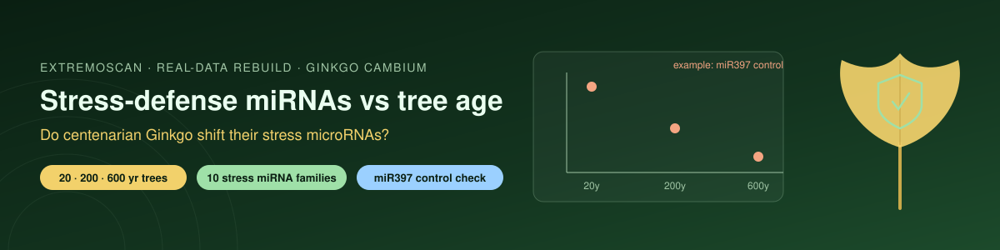

# 🌳🛡️ Do Stress-Defense microRNAs Change with Age in Centenarian Ginkgo?

-2e7d32)  

**Author:** Riddhika D

## Question
Very old trees survive centuries of drought, cold, UV and pathogens. A simple, testable slice of "stress resilience in centenarian plants": do the microRNAs **known to regulate plant stress and defense** shift as *Ginkgo biloba* ages from 20 → 200 → 600 years?

## Data
NCBI GEO **GSE119213** (Wang et al. 2020, *PNAS*) — small-RNA read counts from the vascular cambium of trees aged 20, 200 and 600 years (2 trees per age). Real data, downloaded live in the notebook. Same dataset as the companion Ginkgo-longevity repo, but a **different pre-registered question**: stress/defense miRNAs, not the juvenility/longevity ones.

## Method (fixed before looking at results)
- **Stress/defense miRNA families:** miR393, miR160, miR167, miR398, miR408, miR395, miR399, miR319, miR159, miR402.
- **Positive control:** miR397 (shown to fall ~77× with age in Wang 2020 and in the longevity repo) must come out strongly age-associated, or nothing else is trusted.
- CPM, log2(CPM+1), keep mean CPM ≥ 10; linear trend of log2 CPM vs log10(age); Benjamini–Hochberg FDR.
- **Set test:** is the mean |r| of the stress miRNAs higher than 10,000 random same-size miRNA sets?

## Result
Ran live on real GSE119213: 632 miRNA names → **601 distinct molecules** after merging cross-species duplicates (2 trees each at 20/200/600 yr); 289 pass the CPM ≥ 10 filter.

- **Positive control PASS:** miR397 falls sharply with age (log2FC = −6.27, r = −0.995, FDR = 0.010). Data and method trusted.
- **Set-level result: NULL.** As a group, the 9 distinct stress/defense miRNAs are **not** more age-associated than random miRNAs — in fact slightly less (mean |r| 0.39 vs 0.59 random; empirical set p = 0.98). There is no broad "stress-miRNA remodelling" with Ginkgo age.
- **No individual stress miRNA survives correction:** **0 of 9** pass FDR < 0.1. The strongest is **miR408** (copper/drought), down ~14× from 20 → 600 yr (log2FC = −3.81, r = −0.92), but at **FDR = 0.12** it does not cross the threshold. miR167d is next (FDR = 0.15). After merging duplicate names, miR408 is **one** molecule (3 aliases), not four.
- **Descriptive note:** miR397 (control) and miR408 are both copper-responsive miRNAs (SPL7/copper regulon) and both decline in old cambium — internally consistent, but miR408 is not statistically significant here, and miR397's decline was already reported by Wang 2020.

**Honest verdict:** a clean **null**. Stress/defense miRNAs are broadly stable across the Ginkgo lifespan; the one copper-miRNA (miR408) that trends down does not survive multiple-testing correction. Novelty: none beyond confirming the known miR397 decline.

## Honest limits
- **n = 2 trees per age** → exploratory, not proof. the miR408 trend (FDR 0.12) needs more trees to confirm.
- miRNA names are cross-species mappings of Ginkgo reads; family calls are approximate.
- A **null is a likely and honest outcome**, and would say stress-defense miRNAs are broadly stable across the Ginkgo lifespan.

## Why this repo replaces "Project ExtremoScan"
The earlier ExtremoScan notebooks were **entirely simulated** — invented methylation decay, invented TPM values, hand-typed protein "% identity", and fabricated "human rescue survival" numbers (`np.random` around chosen targets). None of it came from data. This repo keeps only a real, testable question and runs it on real GEO data with a positive control. Nothing here is fabricated.

## Files
| File | Purpose |
|---|---|
| `ginkgo_stress_mirna_aging.ipynb` | Full analysis |
| `ginkgo_stress_mirna_aging_RUN.ipynb` | Same notebook with outputs (add after running) |
| `ginkgo_stress_mirna_trend.csv` | Per-miRNA age-trend table |
| `ginkgo_stress_mirna.png` | Volcano plot, stress miRNAs + miR397 control |

## References
- Wang L et al. (2020) Multifeature analyses of vascular cambial cells reveal longevity mechanisms in old *Ginkgo biloba* trees. *PNAS* 117:2201–2210.
- Data: NCBI GEO GSE119213.
